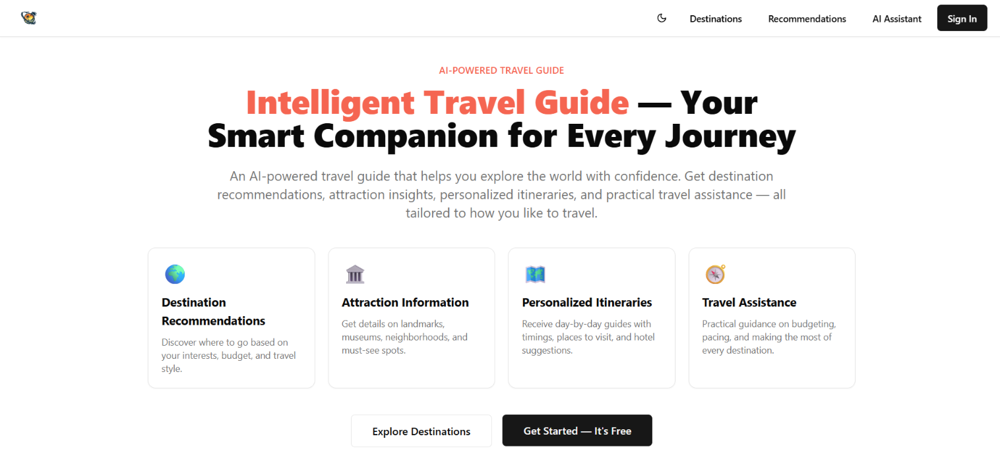
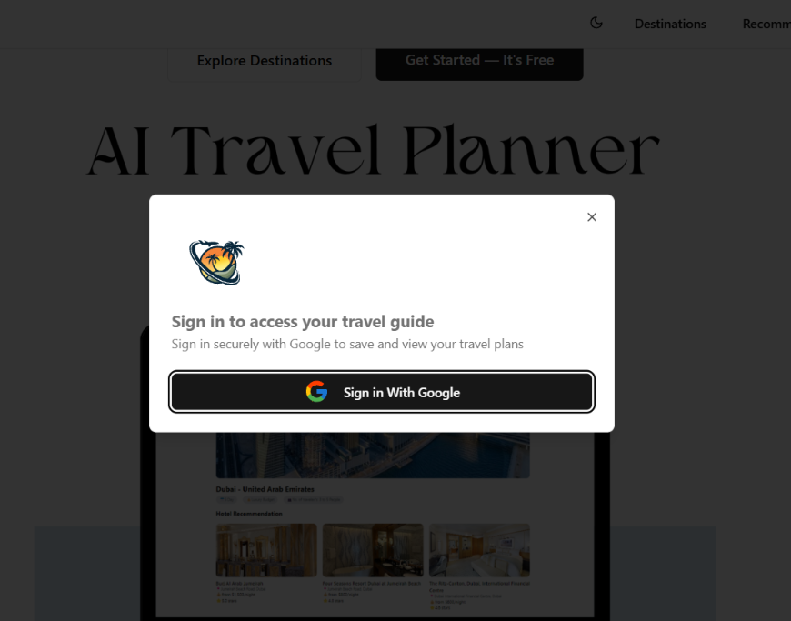
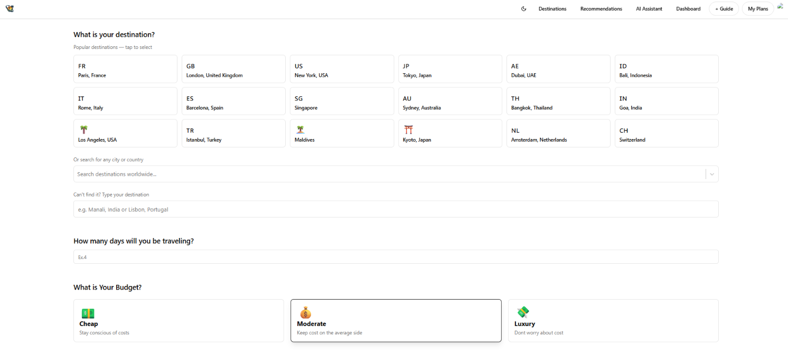
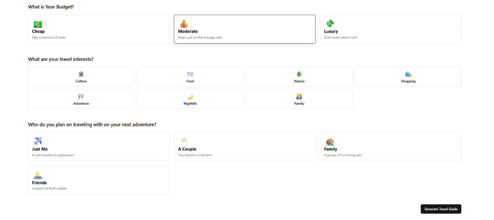
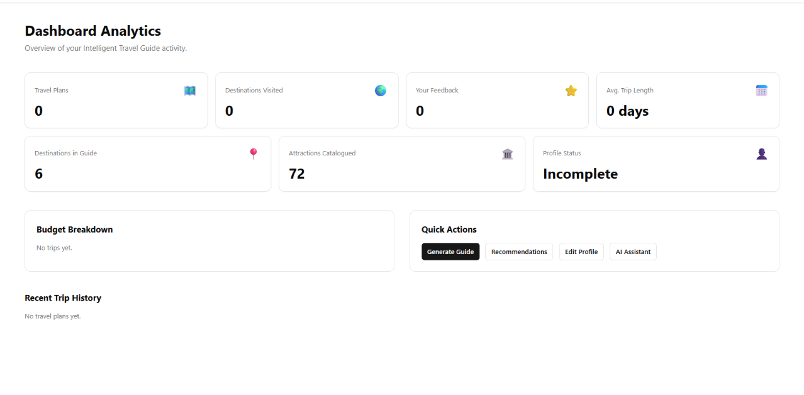
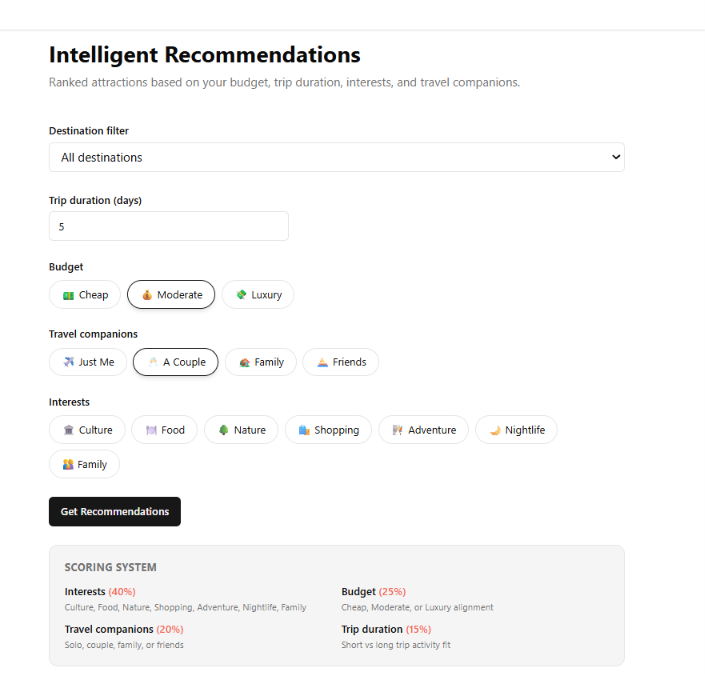

<h1 align="center" style="font-weight: bold;">Intelligent Travel Guide</h1>

<p align="center">
<a href="#tech">Technologies |</a>
<a href="#features">Features |</a>
<a href="#layout">Layout |</a>
<a href="#pre">Prerequisites</a>
 
</p>

<p align="center">An AI-powered travel guide web application that helps users explore destinations with personalized recommendations, attraction information, day-by-day itineraries, and practical travel assistance. The app integrates Google Generative AI for intelligent guidance, Firebase for data storage, and Google Places API for detailed place and hotel information.</p>

<h2 id="technologies">💻 Technologies</h2>

<b><em>Frontend:</b></em>

- React: For building the user interface and handling frontend logic.
- TailwindCSS: For styling and responsive design.
- Axios: For making HTTP requests to external APIs.

<b><em>Backend & Services:</b></em>
- Google Generative AI API: For generating AI-powered destination guidance, itineraries, and recommendations.
- Google Places API: For retrieving detailed information about places, hotels, and their photos.
- Firebase Firestore: For storing and managing user travel plans.
- Firebase Authentication: For handling user authentication via Google OAuth.

<br><h2 id="features">🚀 Features</h2>

- AI-Powered Travel Guidance: Generate personalized itineraries, hotel recommendations, and destination insights using Google Generative AI.
- Destination Recommendations: Discover where to go based on preferences, budget, and travel style.
- Attraction Information: Retrieve and display detailed information and photos of places and hotels using Google Places API.
- Personalized Itineraries: Day-by-day travel guides with attractions, timings, and ticket pricing.
- Travel Assistance: Practical guidance tailored to your trip length, budget, and travel companions.
- User Authentication: Secure user login and authentication with Google OAuth.
- Interactive UI: User-friendly and responsive interface designed with TailwindCSS.
- Data Storage: Persistent storage of travel plans in Firebase Firestore.
- Destination Guide: Browse curated destination pages with culture tips, seasonal guidance, attraction categories, and estimated budgets (mock data).

 
<br><h2 id="layout">🎨 Layout</h2>

<p>
Home Page:


Google OAuth Sign in:
  
  
Destination Guide:


Destinations: <br>


Destinations: <br>


Dashboard: <br>

</p>

AI Assistant: <br>

</p>

Recommendations: <br>

</p>

Locations: <br>

</p>

Locations: <br>

</p>

<h2 id="pre">🗁 Prerequisites</h2>

- Node.js & npm
- Firebase Project: Set up a Firebase project and configure Firestore and Authentication. Obtain your Firebase configuration keys.
- Google API Keys: Obtain API keys for Google Generative AI and Google Places API.

<h2>Application Modules & Routes</h2>

| Module | Route | Description |
|--------|-------|-------------|
| User Profile | `/profile` | Name, country, budget, interests, travel pace |
| Destination Guide | `/destinations` | Browse & search destinations |
| Destination Detail | `/destinations/:id` | Culture, attractions, feedback |
| Attraction Management | `/manage/attractions` | CRUD custom attractions (Firebase) |
| Destination Management | `/manage/destinations` | CRUD custom destinations (Firebase) |
| Intelligent Recommendations | `/recommendations` | Scored attraction matches |
| AI Itinerary Generator | `/create-trip` | Gemini-powered travel guides |
| Travel Assistant | `/assistant` | Chatbot Q&A session |
| Trip History | `/my-trips` | Saved travel plans |
| Dashboard Analytics | `/dashboard` | Usage stats & recent trips |
| View Travel Plan | `/view-trip/:id` | Itinerary + recommendations |

See [IMPLEMENTATION_PLAN.md](./IMPLEMENTATION_PLAN.md) for architecture details.

<h2>Getting Started</h2>

```bash
npm install
npm run dev
```

Create a `.env` file with:

```
VITE_GOOGLE_GEMINI_AI_API_KEY=your_gemini_api_key
VITE_GOOGLE_PLACE_API_KEY=your_google_places_api_key
VITE_GOOGLE_AUTH_CLIENT_ID=your_google_oauth_client_id
```
